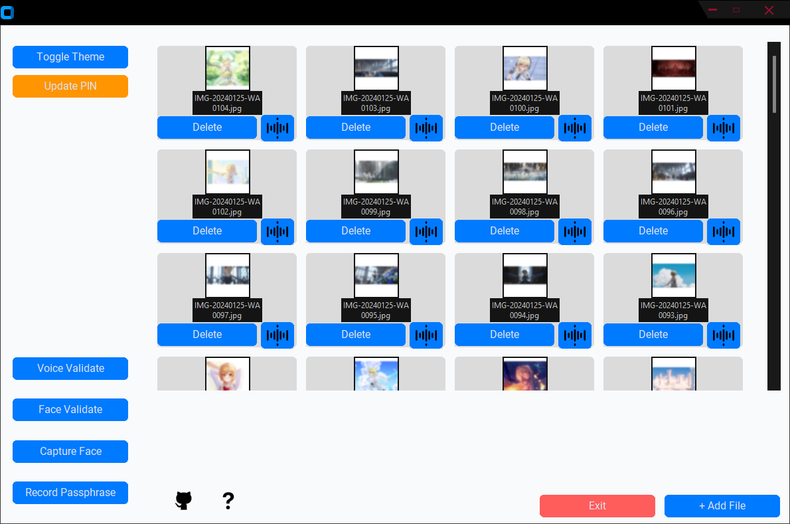
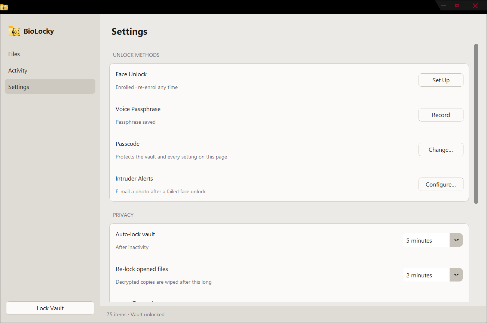

# BioLocky

An encrypted file vault you unlock with your **face**, **voice**, or **passcode**.

<p align="center">
  
  
</p>

Add a file and it's encrypted with AES-256 and moved into the vault. Open it with a quick face or voice check, and it's wiped from your disk again a couple of minutes later.

## Features

- **Strong encryption.** AES-256-GCM, with keys protected by your passcode (scrypt). Tampering is detected.
- **Face and voice unlock.** Opening one file unlocks the rest for the session.
- **Move, don't copy.** Originals are removed once the encrypted copy is verified.
- **Auto-relock.** The vault locks when idle, and opened files are wiped after a timer, on lock, and on exit.
- **Recovery code.** A one-time code is shown at setup in case you forget your passcode.
- **Intruder log.** Failed face unlocks are logged with a photo, with optional e-mail alerts.
- **Easy to manage.** Multi-select, export, delete, and Explorer-style sorting.
- **Clean UI.** Light and dark themes.

## Quick start

```bash
git clone https://github.com/syed177013/BioLocky-A-Biometric-based-File-Lock.git
cd BioLocky-A-Biometric-based-File-Lock
pip install -r requirements.txt
python main.py
```

On first launch, choose a passcode and **save the recovery code**. Then go to **Settings** to set up Face Unlock and a Voice Passphrase.

> Requires Python 3.10+, a webcam for face unlock, and a microphone for voice unlock.
> On Windows, if `pyaudio` fails to install, use `pip install pipwin && pipwin install pyaudio`.

## Using it

| Action | How |
|---|---|
| Add files | **Add Files** (originals are moved into the vault) |
| Open a file | Double-click → face / voice / passcode check |
| Select several | Ctrl/Cmd-click, Shift-click, or **Select All** |
| Export / delete | Select files → **Export** or **Delete** |
| Sort | **Sort by** menu: name, date, type, size |
| Lock now | **Lock Vault** (bottom left) |

## Build an EXE (Windows)

```bash
pip install pyinstaller
pyinstaller --noconsole --onefile --name BioLocky --icon app_icon.ico ^
  --add-data "resources;resources" --add-data "icons;icons" --add-data "app_icon.png;." ^
  --collect-all customtkinter --collect-all speech_recognition main.py
```

The vault is created in a `vault_data` folder next to the EXE.

## Project layout

```
main.py                 entry point
biolocky/
  config.py             paths, settings, app icon
  crypto.py             AES-GCM streaming, scrypt, key wrapping
  vault.py              keys, index, import/export, temp-file cleanup
  face.py  voice.py     camera and mic work (background threads)
  mailer.py             intruder e-mail alerts
  legacy.py             import from BioLocky 1.x
  ui/                   theme, widgets, sheets, app
```

## Security notes

- **No passcode and no recovery code means no recovery.** There is no backdoor.
- Voice recognition uses Google's online speech service, so audio is sent for transcription. It is never saved to disk.
- Face matching is lightweight and **can be fooled by a photo**. Treat it as a convenience layer on top of your passcode, not a replacement for it.
- Secure-delete is best-effort on SSDs.

## License

MIT. Add a `LICENSE` file before publishing.
