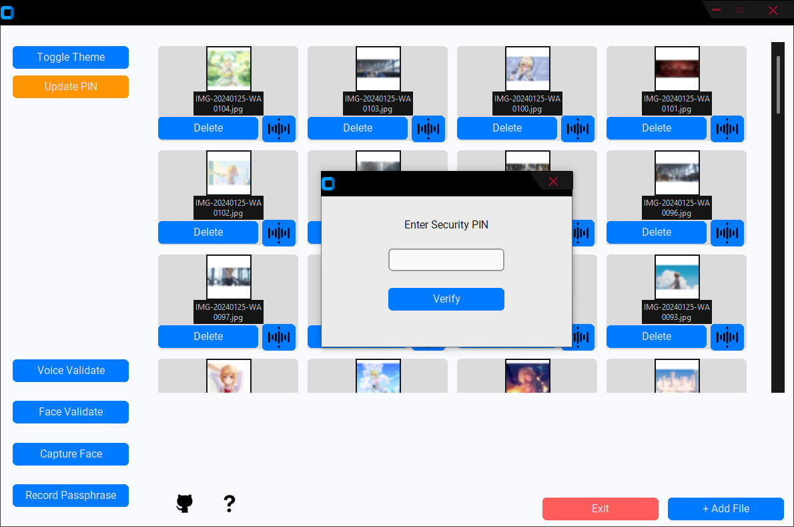

# BioLocky 

**A Biometric-based File Lock Application** built in Python.

Add a file and it's encrypted with AES-256 and moved into the vault. Open it with a quick face or voice check, and it's wiped from your disk again a couple of minutes later.

Since it's pure Python with common libraries, it runs on **Windows, macOS, and Linux**.
Made Jointly by me, @FaizanMohd5 and Mohd Yusuf Hussain




---

## Features

- **Multi-factor Authentication**
  - Face Recognition (OpenCV)
  - Speech Recognition (Google Speech Recognition)
  - Traditional PIN fallback
- **Automatic Encryption & Decryption**
  - Uses AES encryption via the `cryptography` library
  - Files are encrypted when locked and decrypted only after successful authentication
- **Intruder Detection**
  - Captures a photo of anyone who fails authentication multiple times
  - Automatically sends the intruder’s photo to your email (configured in `mail.py`)
- **Modern & Responsive UI**
  - Built with **CustomTkinter** for a beautiful dark/light mode interface
- **Cross-Platform**
  - Works on Windows, macOS, and Linux
- **File & Folder Monitoring**
  - Uses `watchdog` to monitor protected directories

---

## Requirements

- Python 3.8 or higher

### Dependencies

```bash
git clone https://github.com/syed177013/BioLocky-A-Biometric-based-File-Lock.git
cd BioLocky-A-Biometric-based-File-Lock
pip install -r requirements.txt


First launch using main.py : Register your face, voice phrase, and PIN
Add files/folders you want to protect
Lock them → files get encrypted automatically
Unlock using face, speech, or PIN
Multiple failed attempts → intruder photo captured and emailed


Important Notes

Webcam and microphone must be available
Good lighting helps face recognition accuracy
Speech recognition performs best in quiet environments
Use a Gmail App Password for reliable email alerts
Since its Pythons CV, Having a GPU kinda Helps
